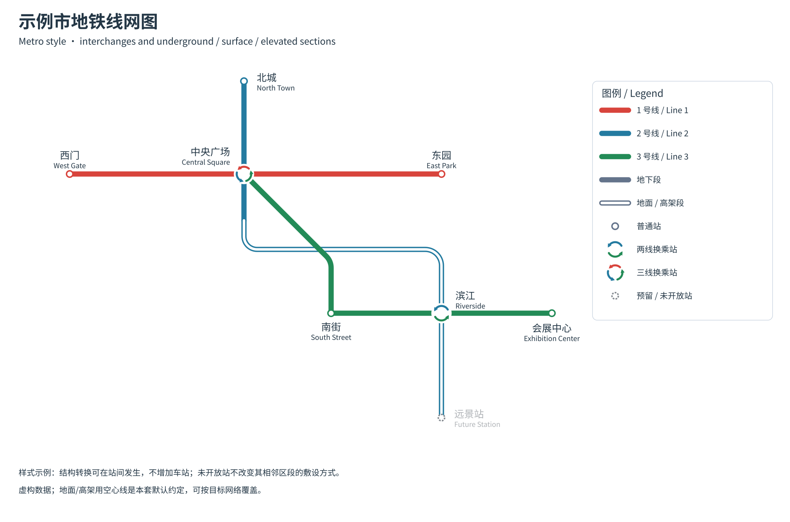
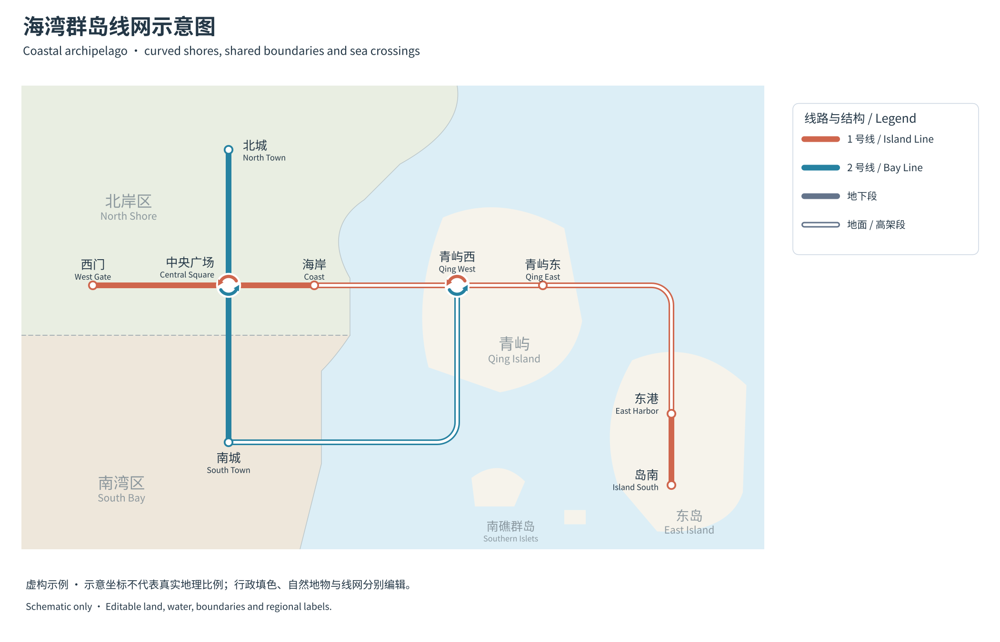
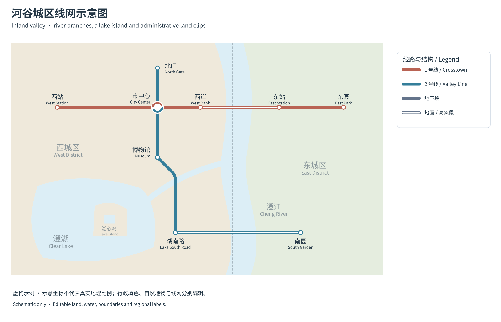
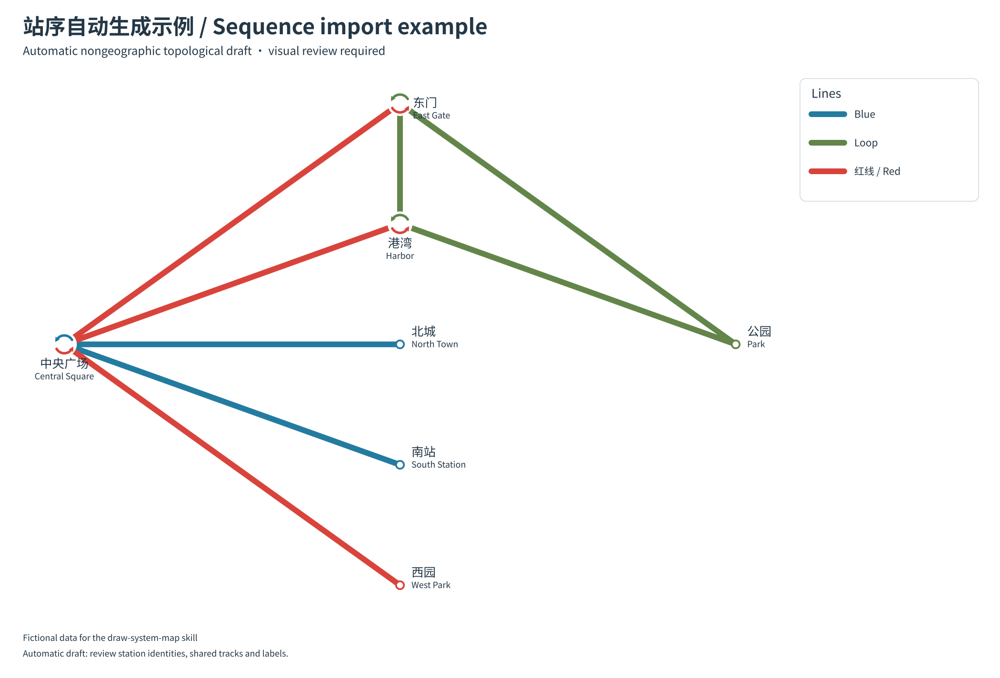
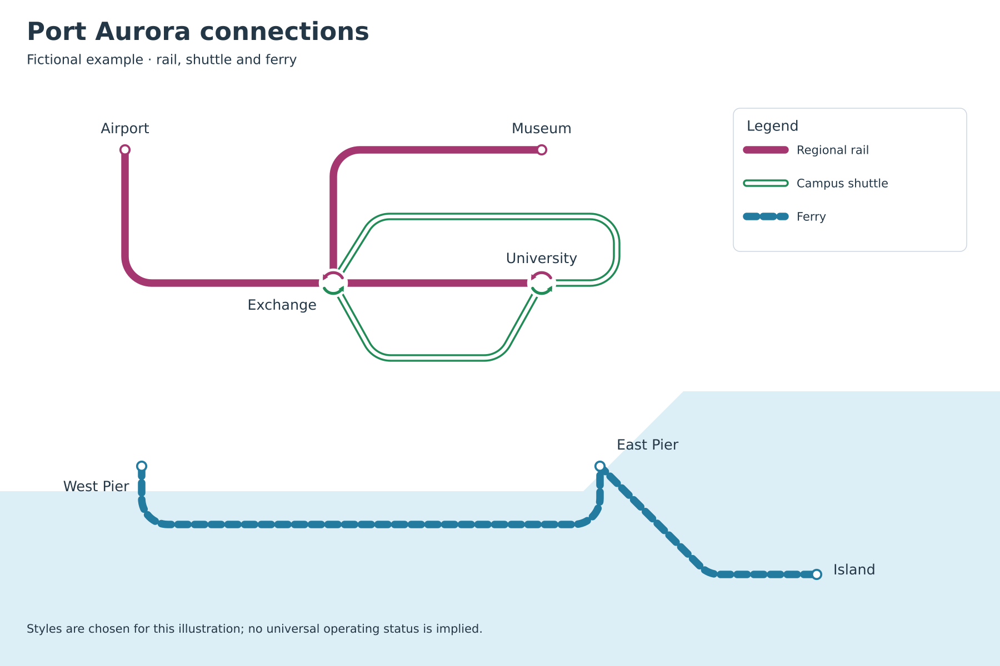

# 通用线网图绘制 Skill

**厦门地铁线网图风格的地铁线网图绘制 skill**

为不同城市、不同交通方式绘制可编辑的线网示意图。现在可直接提供国家、城市和线路范围，由 Agent 查找官方数据、导入站序并自动生成初稿；也可从 GTFS 链接/ZIP、站序 CSV、参考图片或已有 SVG 开始，适用于地铁、公交、有轨电车、市域铁路、轮渡和混合网络，也可用于结构相似的节点连线图。

以厦门地铁线网图的圆角线路、清晰换乘和中英文标注为视觉参考，也支持用户指定的其他风格。城市名称、站数、颜色、语言、线型和图例语义均由输入决定，不依赖任何城市项目或专项校验。



## 从城市名称开始

```text
使用 $draw-system-map，绘制芬兰赫尔辛基地铁 M1/M2 线网图。
先查找官方数据并说明日期，提取站序、支线和共享车站，无需我逐站录入。
保留原文名称，生成初稿后调整密集标签，交付源文件、可编辑 SVG 与 PNG。
```

默认流程为：**找来源 → 导入站序/身份 → 自动初稿 → 查看与微调 → 导出**。优先官方 GTFS；没有 GTFS 时由 Agent 读取官方线路页/API，整理为统一输入。工具不保证每个城市都有完整公开数据，也不把初稿视为已完成精排。

- [城市检索、数据下载、生成器与局部修订手册](references/import-guide.md)
- [GTFS/CSV/拓扑 JSON 输入约定](references/source-data-format.md)
- [美国 BART、芬兰 HSL 实际来源验收](references/import-validation.md)

## 已包含的地铁制图风格

| 元素 | 默认表现 |
| --- | --- |
| 普通站 | 白底、线路色圆形描边 |
| 两线换乘 | 上下两段独立的双色半环箭头 |
| 三线换乘 | 三个独立箭头按 0°/120°/240°分布，颜色方位可指定 |
| 预留/未开放站 | 灰色虚线节点或灰色换乘箭头，站名降低显著度 |
| 地下段 | 线路色实心线 |
| 地面/高架段 | 同一路径叠加白色内芯形成空心线，保留圆角和圆头 |
| 站间结构转换 | 相邻区段共用边界坐标，不增加车站 |
| 图例 | 可加入结构线型、普通站、两线/三线换乘和预留站 |

这些是可覆盖的默认约定。可以改用多色换乘环，或者为目标网络调整地面/高架线型；不依据交通类型自动猜测敷设方式和开通状态。字段、颜色方位及完整示例见[样式规则](references/style-rules.md)。

```bash
python3 scripts/draw_map.py assets/metro-style-network.json --output output/metro-style.svg
python3 scripts/export_png.py output/metro-style.svg output/metro-style.png --scale 1.5
```

## 行政区与自然地理底图

支持独立的陆地、岛屿、水域、河流、行政填色/边界和区域标签。轮廓可用直线或贝塞尔曲线，多面与孔洞可表达湖中岛及岛上池塘；行政填色按指定陆地范围裁切。旧 `regions` 输入继续可用。

[底图绘制手册](references/basemap-guide.md)说明来源整理、跨水关系、轮廓简化、图层、裁切和标签安排。两份虚构示例可直接运行：

```bash
python3 scripts/draw_map.py assets/coastal-basemap-network.json --output output/coastal.svg
python3 scripts/draw_map.py assets/inland-basemap-network.json --output output/inland.svg
python3 scripts/export_png.py output/coastal.svg output/coastal.png --scale 1.5
```





## 后续改进计划

本次发布包含来源下载与 GTFS/CSV 导入、自动初稿与局部覆盖、可编辑 SVG、PNG 预览、通用线网样式和行政区/自然地理底图。Adobe Illustrator 原生 `.ai` 工程导出已转入[后续改进计划](references/roadmap.md)，不作为本次发布条件；公开包不包含其尚未完成原生验收的准备脚本、JSX 和试验手册。

## 安装与调用

将整个仓库作为一个 skill 文件夹使用，保留 `SKILL.md`、`agents`、`scripts`、`references`、`assets` 的相对位置。

项目内安装，在目标项目根目录执行：

```bash
git clone https://github.com/BG2FOU/draw-system-map-skill.git .agents/skills/draw-system-map
```

个人安装可将同一文件夹放入 `~/.codex/skills/draw-system-map`；若设置了 `CODEX_HOME`，则使用其下的 `skills/draw-system-map`。目标目录已有内容时先核对，不覆盖已有 skill。客户端未显示新条目时，在目标项目开启新会话，或提供 `SKILL.md` 的路径。

直接向 Agent 发送：

```text
使用 $draw-system-map，根据指定城市的官方公开数据，或我提供的站序和参考图，绘制轨道交通线网图。
保留原名称和指定配色，区分换乘与普通交叉，交付可编辑 SVG、源数据和 PNG。
```

其他示例：

```text
使用 $draw-system-map 绘制公交干线与有轨电车的混合网络。
单语言标注，使用我给定的色值，环线和支线按数据连接，不套用其他城市的标准。
```

```text
使用 $draw-system-map 重绘这张参考图，保持所有可确认的站名和连接。
看不清的部分列为待确认，不自行补译。保持文字和线路可编辑。
```

如需分阶段提交推送，明确加上“每完成一个可独立验收的阶段，提交并推送当前任务分支”。未提出远端操作时，skill 不自动发布或创建 PR。

## 不使用 Agent 也能运行

SVG 生成仅依赖 **Python 3.10+ 标准库**。以下命令在此文件所在目录运行；也可用脚本的绝对路径从任意目录调用。Windows 如没有 `python3` 命令，可换为 `python`。

```bash
# 不用手填坐标：从随包的虚构站序生成初稿（输出目录须不存在）
python3 scripts/create_map.py build assets/import-examples/station-sequences.csv \
  --title "站序自动生成示例 / Sequence import example" \
  --attribution "Fictional data for the draw-system-map skill" \
  --output-dir output/import-demo --png

# 已有绘图 JSON 可继续使用原入口
python3 scripts/draw_map.py assets/minimal-network.json --output output/network.svg
python3 scripts/draw_map.py assets/minimal-network.json --output output/network.svg --check
```

没有 PNG 环境时去掉 `--png`。实际 GTFS 的下载、线路选择、日期筛选与命令见[导入手册](references/import-guide.md)；CSV/拓扑输入不要求经纬度。只有需要从空白精确构图时，才复制 `assets/minimal-network.json` 手工填写画布坐标。



PNG 导出需要以下任一环境：系统 PyGObject + librsvg/Pango，或 CairoSVG + 系统 Cairo。`--renderer auto` 默认优先使用 librsvg；可显式传 `--renderer librsvg` 或 `--renderer cairosvg`。CairoSVG 可通过 Python 环境安装 `cairosvg`，某些系统仍需单独安装 Cairo。没有这些依赖时 SVG 仍可生成并在浏览器/矢量编辑器中打开。

文字使用实际系统字体；中文示例优先使用 Noto Sans CJK SC，英文示例使用 DejaVu Sans。可以在数据中更换字体，换后重新查看排版。

## 输入数据怎么写

常规导入输入见[来源拓扑与站序 CSV](references/source-data-format.md)。下表是自动生成后可进一步编辑的绘图格式，完整字段说明见 [数据格式](references/data-format.md)：

| 内容 | 表达方式 |
| --- | --- |
| 站点/节点 | 唯一 `id`、`name`、`point: [x,y]`，可选第二语言 |
| 线路 | 名称、颜色、若干 `segments`；不限定交通类型 |
| 一段路径 | `points` 中的字符串引用站点 ID，坐标数组是转弯控制点 |
| 换乘 | 共用站点 ID；`transfer_order` 指定箭头颜色方位；几何交叉不自动合并 |
| 支线 | 同一线路增加多个区段；非站点分岔用共用坐标连接 |
| 环线 | 区段设置 `closed: true`；起点选站点或允许折角的位置 |
| 线型 | `solid`、`hollow`、`dashed`，语义自行定义 |
| 敷设方式 | 线路/区段 `structure`；地下默认实心、地面/高架默认空心，可覆盖映射 |
| 预留/未开放站 | 站点 `status: "reserved"` 或 `"unopened"`，不自动改变相邻轨道 |
| 标签 | 用站点 `label.offset` 和 `anchor` 调整，不移动站点身份 |
| 背景与说明 | `regions` 多边形与 `annotations` 文字 |

布局方法见 [绘图指南](references/drawing-guide.md)。绘图器会把转弯控制点圆角化，保持站点坐标精确。前置生成器提供初稿布局、密集站点拉开、共享站间线路错开与冲突报告；复杂交会和长站名仍需查看并调整，不保证全网最优或零碰撞。复杂风格可以扩展生成器或继续使用已有项目的绘图实现。

## 支线、环线与混合网络示例

```bash
python3 scripts/draw_map.py assets/multimodal-network.json --output output/multimodal.svg
python3 scripts/export_png.py output/multimodal.svg output/multimodal.png --scale 1.5
```



这份虚构数据同时包含铁路支线、接驳环线、轮渡、实线/空心线/虚线、单语言标签与背景区域。示例只演示结构，不规定任何真实交通类型的画法。

## 输出、修改与基本检查

SVG 保留线路路径、站点、换乘箭头/环和 `<text>` 文字，并按图层分组。用矢量编辑器查看或编辑都可以；希望修改在以后重生成时保留，需要回写 JSON 或生成器。PNG 是预览和分享格式，不替代源文件。

工具只拒绝重复 ID、不存在的站点引用、非有限坐标等无效数据。`--check` 仅检查输入与 SVG 是否一致，不证明布局无冲突。交付前查看全图与密集区域，确认站序/连接正确、文字可读、没有缺字、遮挡、压线、裁切或标签错认。

工具自身的可移植性测试：

```bash
python3 -m unittest discover -s tests -v
```

测试不含任何城市固定站数或交通类型规格。公开发行包包含 62 项测试：55 项标准库检查和 7 项可选 librsvg 像素回归，覆盖 GTFS 停站/父站/日期、分组、CSV、来源下载、确定性布局及覆盖、命令行流程，以及换乘、线型、旧模板一致性、几何/引用、底图孔洞与裁切。缺少 PyGObject/librsvg 时像素测试明确跳过。本次 Linux 环境全部通过，并查看五份原示例及新增站序初稿；Windows、macOS 和 CairoSVG 尚未实测。

## 常见问题

- **没有数据文件：** 提供国家、城市和线路范围，Agent 先查官方来源；无可用来源时说明具体缺项。
- **没有原始坐标：** 站序 CSV/拓扑输入可生成非地理初稿；完整经纬度可生成保留大体方位的初稿。
- **同一线路被画成两条线：** 检查来源是否拆分方向 ID，按来源建立 `--route-groups` 显式映射。
- **同名站不该换乘：** 使用不同 ID；需要合并时由来源明确为同一节点后共享 ID。
- **图面重叠：** 查看 `report.json` 和图面，用独立覆盖文件调整站点/标签/路径；`--check` 不检查视觉质量。
- **中文缺字或字体变化：** 安装/指定合适字体，再重新导出。
- **PNG 提示无渲染器：** 安装可选渲染依赖，或先使用可编辑 SVG。
- **修改 SVG 后又被覆盖：** 把调整写入数据/生成器，而不是只改派生产物。
- **需要特殊图例、箭头或图标：** 沿用已有项目或扩展可编辑 SVG 分组，不把整个图转换为图片。
